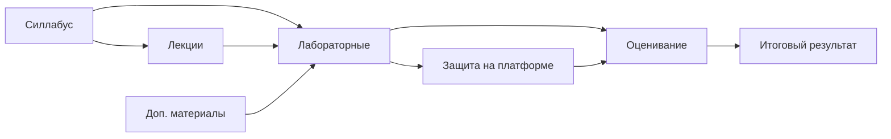

# Контейнеризация и оркестрация приложений

> Учебный репозиторий дисциплины «Контейнеризация и оркестрация приложений» (КонтОркПрил), осень 2026, программа ТОП-ИТ: силлабус, лабораторные, оценивание и размещение решений студентами.

Преподаватель: Аминов Натиг Сабит оглы.

## Быстрая навигация

| Раздел | Назначение |
|---|---|
| [Силлабус](syllabus/README.md) | цели, политика курса, порядок сдачи и защиты |
| [Лекции](lectures/README.md) | темы курса (материалы не включены в репозиторий) |
| [Лабораторные](labs/README.md) | задания, критерии, требования к отчёту |
| [Доп. материалы](materials/README.md) | полезные ссылки и инструкции |
| [Оценивание](assessment/README.md) | баллы, шкала оценок, штрафы |
| [Метаданные](meta/README.md) | соглашения по структуре и Markdown |
| [Решения](solutions/README.md) | куда студенты выкладывают работы, шаблон README для работ |

## Как работать студенту

1. Сделайте свой **публичный** репозиторий на основе этого (кнопка `Fork`).
2. Прочитайте [силлабус](syllabus/course.md): порядок сдачи, баллы и правила.
3. Выполняйте лабораторные по текстам в [labs](labs/README.md); результаты выкладывайте в `solutions/` своего репозитория по [инструкции](solutions/README.md).
4. Запишитесь на защиту через платформу (ссылка в силлабусе).

> [!TIP]
> Преподаватель видит в вашем репозитории, что и когда вы выкладывали, поэтому делайте маленькие осмысленные коммиты.

## Карта курса

